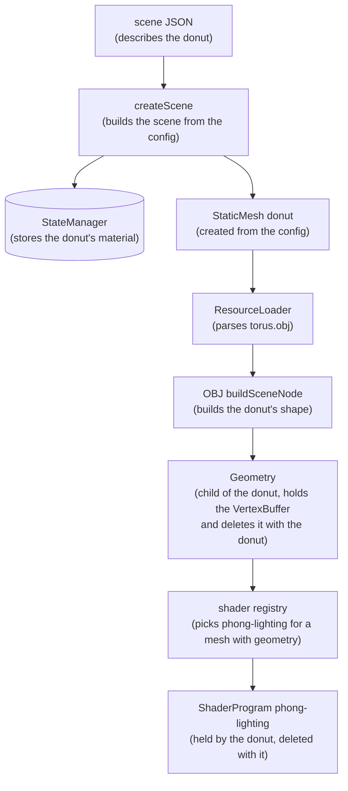
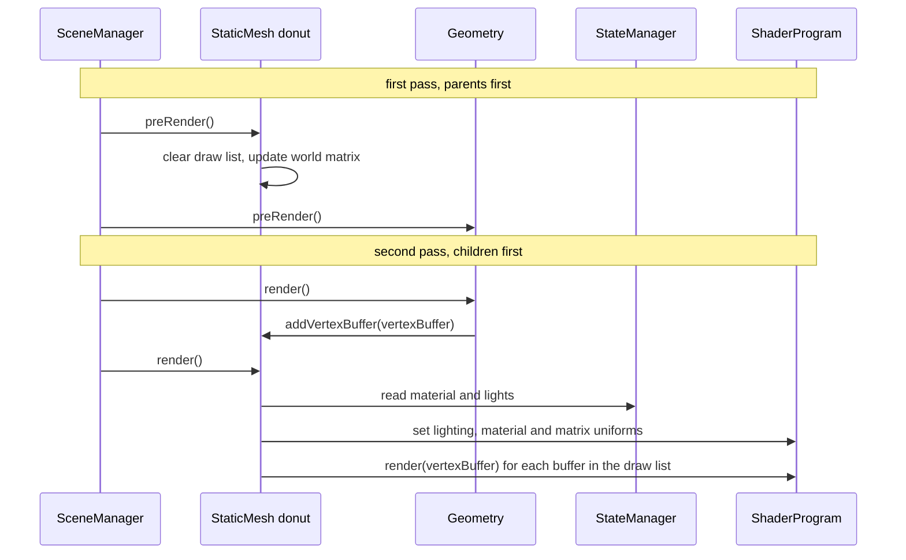

# scenic

Scene graph renderer. Early work in progress.

Scenic uses a configuration first approach to define a scene: a scene is a JSON
file describing a tree of nodes and their state, and Scenic builds and renders
that tree with WebGL.

The editor app renders a scene that you pick from a list, its own or a game's
from `games/` (see [`games/README.md`](games/README.md)). Here it is rendering
skinned animation:


Quick intro:

1. Click on the rendering canvas to take control of the camera
2. Move the mouse to look around
3. W and S fly forward and back, A and D fly left and right, E and Q fly up
   and down
4. Scroll (or two fingers on a trackpad) to fly forward, back, left and right
5. Press C to switch cameras, in scenes with more than one: the dancing
   character can be seen from a free camera, through its eyes, or from behind
   it, and Bubble Squadron's starfighter from behind it, from its cockpit, or
   from a free camera. Looking through the eyes, the mouse looks around.
   Following from behind, the mouse orbits and scrolling zooms
6. Press ESC to let go of the camera
7. Use "Change scene" in the scene graph panel to switch to another scene

## Architecture

### Scene config and state

A scene file like
[`apps/editor/scenes/bump-lighting-sphere.json`](apps/editor/scenes/bump-lighting-sphere.json)
describes a tree of nodes. Each node has a `type`, a `name`, optional state
such as `transform` and `material`, and optionally a `resource` file to load
its shape from. The rest of this section uses a made-up `donut` node as its
example: a static mesh whose shape is loaded from an OBJ file of a torus.

```json
{
  "name": "donut",
  "type": "static-mesh",
  "resource": "/resources/obj/torus.obj",
  "material": {"color": [0.8, 0.5, 0.2, 1]}
}
```

Building a scene splits that config in two:

- The **`SceneManager`** holds the tree of nodes: what exists and how it is
  nested.
- The **`StateManager`** holds the state of every node, keyed by node ID:
  transforms, materials, lights, animation settings. Nodes read their state
  from it every frame, and the editor's panels write to it.

### Viewports and cameras

A **`Viewport`** is a part of the scene seen through a camera. Its items are
what it draws, and its cameras are the angles it can draw them from. The
editor's scenes have two viewports: `world`, with the lights and models, and
`axis`, with the axis gizmo in the corner.

The player's input goes to the cameras of the viewport marked `"input": true`,
such as `world`. A scene can mark one; one without, such as a menu, has no
cameras for the player to move.

A **`Camera`** is a lens plus a placement:

- Its `projection` block is the lens. Its `type` is one of:
  - `perspective`, which makes things further away look smaller. It takes
    `fov` (the vertical field of view in degrees), `near` and `far`.
  - `orthographic`, which keeps things the same size however far away they
    are. It takes `far`, and is measured in pixels from the bottom left of the
    canvas, which is what the axis gizmo needs.
- Its `transform` places it in the world like any other node. It looks down
  its own -Z axis.

A viewport can have several cameras, and draws through one of them at a time:
the camera named by `activeCamera` in the viewport's state, or its first camera
when that is not set. Switching cameras is a state change:

```js
sceneManager.updateNodeStateByID("world", {activeCamera: "side camera"});
```

Each camera keeps its own state, so switching back returns to where that camera
was left. A name that matches no camera falls back to the first camera, with a
warning in the console. In the editor, C switches to the next camera, and a
camera's Info tab shows whether it is active, with a button to look through it.

A viewport must always have a camera. Loading a scene with a viewport that has
no camera fails with an error that names the viewport, and removing a
viewport's last camera throws.

```json
{
  "name": "world",
  "type": "viewport",
  "input": true,
  "items": [
    {
      "name": "camera",
      "type": "free-fly-camera",
      "projection": {"type": "perspective", "fov": 30, "near": 1, "far": 10000},
      "transform": {"position": [0, 0, 300]},
      "freeFly": {"speed": 200, "maxPitch": 89}
    }
  ]
}
```

#### Camera types

A camera's `type` says how it moves. A plain `camera` stays where its
transform puts it, like the axis gizmo's. The others are moved by the
`SceneRunner`, which runs the input viewport's cameras with a `CameraSystem`
from the `@scenic/camera` package (`packages/camera/`), and gives them the
player's camera intents every frame, even while paused (see
[Input intents](#input-intents)): switch to the next camera, fly, look and
zoom. Each type
has a behavior class there, and its settings in a block named for it. The behaviors keep nothing
themselves: everything a camera does as you play, such as its orbit, zoom and
the way it keeps flying while a key is held, is written back to its settings
block, so switching cameras and back finds each one as it was left, and a
saved state puts every camera back where it was. The values in the scene file
are where each camera starts.

A camera's settings can include `"mouseOrbit": false` to leave the mouse to
the scene, such as for steering a rocket: the mouse then doesn't turn that
camera, except while the scene is paused.

- **`free-fly-camera`** (`freeFly`) flies around the scene. Its rotation is
  `[pitch, yaw, 0]` in degrees, and lights and models stay where they are in
  the world while it moves around them.
  - `speed`: how fast it flies, in scene units per second.
  - `maxPitch`: how far up or down it can look, in degrees. Looking straight up
    or down would flip the camera over, so keep this under 90.
  - `movement`: which way it keeps flying while keys are held, as
    `{forward, right, up}`, each -1, 0 or 1. Still without it.
- **`first-person-camera`** (`firstPerson`) looks out from a node, such as a
  character's head bone, and moves with it, animation included. The mouse looks
  around from there, and the camera cannot move on its own.
  - `target`: the node to look out from (see targets below).
  - `offset`: where the camera sits relative to the target, in the target's
    own coordinates, as `{"position": [x, y, z], "rotation": [x, y, z]}`.
  - `maxPitch`: how far up or down it can look from where the target faces, in
    degrees.
  - `look`: where it is looking, as `[pitch, yaw]` in degrees from where the
    target faces. Straight ahead without it.
- **`third-person-camera`** (`thirdPerson`) stays behind a node, such as a
  character, and follows it as it moves and turns. When the node turns, the
  camera swings around with it, staying level: only the node's heading counts,
  not its leaning or tilting. The node's front is its local +Z axis. The mouse
  orbits around it from there, and scrolling zooms in and out. Its settings
  can be changed live from its Third person tab.
  - `target`: the node to orbit and follow (see targets below).
  - `offset`: where the orbit's pivot is relative to the target's position, in
    world coordinates, as `[x, y, z]`.
  - `distance`, `minDistance`, `maxDistance`: how far from the pivot the camera
    is, and how close and far zooming can go, in scene units.
  - `rotation`: the orbit, as `[pitch, yaw]` in degrees, relative to behind the
    target. A yaw of 0 is directly behind it, and a negative pitch looks down
    at it.
  - `maxPitch`: how far above or below the target it can orbit, in degrees.
  - `followTime`: how quickly the camera catches up when the target turns, in
    seconds. After `followTime` it has closed about two thirds of the gap, so a
    quick turn swings the view around smoothly instead of snapping. 0 keeps it
    exactly behind.
  - `lookUp`: how far it tilts its view up from the pivot, in degrees.
  - `heading`: the heading it is at, in degrees, which trails the target's.
    Without it, the camera starts right behind the target.

A **target** names a node in two parts, `{"nodeID": ..., "boneName": ...}`,
so that it picks out one character even when several share the same model:

- `nodeID`: the ID of a node from the scene config, such as a character. Node
  IDs are unique.
- `boneName`: the name of a node inside the `nodeID` node, such as a bone of a
  character's skeleton. It is only looked up there, where a skeleton's bone
  names are unique. Without it, the target is the `nodeID` node itself, which
  is how a model without a skeleton is targeted: the Jedi star fighter's
  third-person camera uses `{"nodeID": "jedi star fight"}`.

The camera waits until the target exists, since a model's bones only exist
once it has loaded, and finds it again if the model is rebuilt. An FBX model's
node names are the same every time it loads; a name that repeats within one
file gets `_n1`, `_n2` and so on.

The dancing character has one camera of each type: a free camera, one
through its eyes, and one following it from behind.

```json
{
  "name": "eyes camera",
  "type": "first-person-camera",
  "firstPerson": {
    "target": {
      "nodeID": "skinning mesh animation",
      "boneName": "mixamorig:Head - Model_LimbNode"
    },
    "offset": {"position": [0, 6.4, 9.3], "rotation": [0, 180, 0]},
    "maxPitch": 80
  }
},
{
  "name": "chase camera",
  "type": "third-person-camera",
  "thirdPerson": {
    "target": {
      "nodeID": "skinning mesh animation",
      "boneName": "mixamorig:Hips - Model_LimbNode"
    },
    "offset": [0, 40, 0],
    "distance": 400,
    "minDistance": 100,
    "maxDistance": 1500,
    "rotation": [-15, 0],
    "maxPitch": 80,
    "followTime": 0.4
  }
}
```

The first-person offset puts the camera between the eyes, and turns it around
to face the same way as the head: the camera looks down its own -Z axis, and
the head's front is its +Z. The third-person offset moves the orbit's pivot up
from the hips to the chest.

Bubble Squadron (`games/bubble-squadron/race.json`) has a chase camera that
follows the player's starfighter, a cockpit camera that looks out from just
above its canopy, banking with it, and a free camera:

```json
{
  "name": "cockpit camera",
  "type": "first-person-camera",
  "projection": {"type": "perspective", "near": 1, "far": 12000, "fov": 75},
  "firstPerson": {
    "target": {"nodeID": "starfighter"},
    "offset": {"position": [0, 40, 30], "rotation": [0, 180, 0]},
    "maxPitch": 80,
    "mouseOrbit": false
  }
}
```

### Input intents

Cameras and menus don't read keys, the mouse or fingers. They read intents:
what the player means, the same whatever device they used
(`packages/dom/src/input-intents.js`). For cameras, `look {x, y}` in
degrees, `zoom` in scene units, `move {forward, right, up}` to keep flying,
and `nextCamera`. For menus, `navigate {x, y}` a step at a time,
`choose {index}` to pick an item directly, `select` and `back`.

Each device has an adapter that subscribes to the app's `InputCapture` and
turns its events into intents for the context the player is in: `camera`
while the top scene has cameras, and `menu` while it is a menu:

| Intent       | Keyboard and mouse                 | Touch            |
| ------------ | ---------------------------------- | ---------------- |
| `look`       | mouse, while the pointer is locked | one-finger drag  |
| `zoom`       | wheel                              | two-finger pinch |
| `move`       | W, A, S, D, E, Q held              |                  |
| `nextCamera` | C                                  | two-finger tap   |
| `navigate`   | arrows, W, S                       | swipe            |
| `choose`     | clicking an item                   | tapping an item  |
| `select`     | Enter, Space                       | tap              |
| `back`       | Escape                             |                  |

The adapters own their bindings, which can be changed to rebind them,
their gestures, and their units, so a camera turns as far for a drag as for
the same move of the mouse. The app publishes intents on the scene's input
channel, and the `SceneRunner` adds them up per frame as `intents`, for the
cameras and for scripts such as `menu.js`. The keys and mouse also still
reach scripts as they are, for scripts that read them, such as a ship's
flight controls, until those move to intents too. Typing text, such as into
a name field, is left to the page's own text fields, and isn't an intent.

### Scripts

A script lets code decide what a node does each frame, such as moving it,
without writing a new node type. A node's config attaches one with `script`,
and the script's `settings` are part of the node's state:

```json
{
  "name": "light-cyan",
  "type": "light",
  "script": {
    "src": "/resources/scripts/orbit.js",
    "settings": {"center": [0, 150, 0], "radius": 300, "speed": 60, "phase": 120}
  }
}
```

A script exports a factory that takes the node and returns the script's hooks,
so every node using it gets its own instance:

```js
const {angles} = require("@scenic/math");

module.exports = function createScript(node) {
  return {
    update(context) {}, // once a frame, before the scene is drawn
    render(context) {}, // just after the node's own render, every draw
    dispose() {}, // when the scene is disposed
  };
};
```

Every hook is optional. `update` is where a script changes the scene's state:
`SceneManager.update` calls it once a frame, parents before children, and the
frame is drawn after, so the changes show up in the same frame. Drawing
(`SceneManager.render`) never runs `update`, so a frame can be drawn as often
as needed without moving anything, and a script's `render` must leave the
state alone too. Another node's world matrix is where that node was last
drawn. `update`'s `context` has the frame's time in `ms` and the
`sceneManager`. In the editor
it also has `seconds` since the last frame, and the player's input: the `keys`
being held, by `KeyboardEvent.code`, the keys `pressed` this frame, even if
they also came up, so a quick tap is never missed, and how far the `mouse`
moved since the last frame, as `{x, y}` in pixels.

The app publishes the player's input as events on `sceneManager.input`, an
`EventBus` that keeps every event of a frame in order: `{type: "keydown", code}`, `{type: "keyup", code}`, `{type: "mousemove", x, y}` and `{type: "wheel", x, y}`, on the `"player"` channel. The editor and the arcade get
them from an `InputCapture` (`@scenic/dom`), the only code that listens to
the page's input, which hands plain events to small subscribers, each with
one job: a router that sends them to the right scene, and the app's own
keys, such as P to pause. The `SceneRunner` adds up each frame's events into
`keys`, `pressed`, `mouse` and `wheel`, for the cameras (see
[Camera types](#camera-types)) and the scripts, and a script gets those of the channel named
by `input` in its node's state, `"player"` without one, so a network game can
publish other players on channels of their own and have each ship flown by
its own. Input only reaches the scene while the
pointer is locked to it, by clicking it. Scenes load paused, and pressing P
plays and pauses them: while paused, its clock stops, and scripts get no time
and no input until P is pressed again, while the camera can still look
around. The mouse turns the camera while
paused even when its `mouseOrbit` setting is off, so a third-person camera can
orbit the starfighter, and when the scene resumes the camera is reset to the scene
file's values, putting it back behind its target. Scripts are loaded with the scene, and
`src` is relative to the scene file, the way a page's links are relative to the
page, so a game's scenes find the scripts next to them in any app. Scripts
that games and apps share, such as `hover.js` and `flame.js`, are in
`resources/scripts`, and scenes load them by absolute path, such as
`/resources/scripts/hover.js`.

Scripts run like CommonJS modules: the editor fetches the script and runs it
inside a function given `require`, `module` and `exports`
(`packages/runtime/src/script-loader.js`). `require` returns the app's own copies of
`@scenic/math`, `@scenic/scene`, `@scenic/animation` and `@scenic/renderer`, so
scripts share the app's classes, and requiring anything else is an error.
Scripts that need other libraries can bundle them with their own build: write
ES modules, mark the `@scenic` packages as external, and output CommonJS. A
bundled `export default` works too. Errors in a script show the script's name,
because the editor names its code with `//# sourceURL`.

The dancing character's three lights each run `resources/scripts/orbit.js`,
with phases of 0, 120 and 240 degrees, so they circle the dancer evenly spaced.

The Jedi star fighter runs `resources/scripts/hover.js`, which makes it bob,
bank and tip its nose as if it were holding position in the air:

```json
"script": {
  "src": "/resources/scripts/hover.js",
  "settings": {"bob": 5, "roll": 6, "pitch": 2, "period": 6}
}
```

Every scene's axis gizmo runs `resources/scripts/axis-gizmo.js`, which turns
it against the `world` viewport's active camera, so it shows the world's axes
as that camera sees them. Its `viewport` setting follows another viewport's
camera instead.

### Racing

Bubble Squadron is a race. Its `race` node runs
`games/bubble-squadron/scripts/race.js`, and its children are the course's
gates, in the order they are flown through: bubble rings from
`bin/generate-gate.js`, with the start gate first: a checkered gantry across
the course, wide enough for racers side by side and always solid, so the start
and finish are clear. A ring counts racers flying through it within
`gateRadius` of its center, and the gantry anywhere in its opening, which its
node's state gives as `"gate": {"width": 2000, "height": 800}`, from the
ground up. Flying through the start gate starts the clock, a lap is every gate
in order and then the start gate again, and after the last lap the race is
over, until the start gate starts it again. A gate only counts when it is next and flown
through the way it faces, along its +Z axis. The next gate glows, and the
ones already flown through this lap fade. A course leaves room around the
start gate: the first and last gates are placed by their distance from the
start gate, not from each other, so racers start in the clear and see the
finish coming:

```json
"script": {
  "src": "scripts/race.js",
  "settings": {"racer": "starfighter", "laps": 3, "gateRadius": 300}
}
```

The race keeps its lap, next gate, time, lap times and best time in its
settings, and tells the app's UI how it is going, as described next.

### Telling the UI: `sceneManager.ui`

A scene tells the app's UI what it knows, such as a race's lap and time for
the HUD, through `sceneManager.ui`, a small pub/sub (`BufferedEventBus` in
`@scenic/scene`). A node or script publishes plain data on a channel, and
the app, which knows what each channel's messages hold, shows them however
it likes. The scene never knows about the page, or about other nodes that
show things.

A node publishes on the channel named by `hud` in its own state, and
publishes nothing without one:

```json
{"name": "race", "type": "transform", "hud": "race", "script": {"src": "scripts/race.js"}}
```

```js
sceneManager.ui.publish("race", {
  lap: 2,
  laps: 3,
  time: 64.2,
  gate: 4,
  gates: 10,
  best: null,
  finished: false,
});
sceneManager.ui.onUpdate((messages) => {
  /* the app, once a frame, with {race: {...}, terrain: {...}} */
});
```

Messages are kept for the frame rather than sent as they come, so a scene
that publishes often tells the app once a frame. `SceneManager.update` starts
each frame's messages, and `SceneManager.render` sends them once the frame is
drawn: every listener gets the last message on each channel, as
`{channel: message}`. A channel that stops publishing is missing from the
next frame's messages, so the app stops showing it. Drawing again without an
update sends the same frame's messages again.

The race publishes `{lap, laps, time, gate, gates, best, finished}` every
frame, and a terrain `{tiles, drawn, triangles, built}`. Messages are output
worked out from the scene's state, not state themselves: publishing never
changes the scene, so a terrain can publish while drawing, and they are not
saved or synced. The arcade's HUD shows the race; the editor's shows the
race, and a terrain's counts with what the whole frame cost. Each ignores
channels it doesn't know. In the editor, the Info tab of a terrain or a node
with a script sets its `hud` channel.

### Scene stacks and menus

An app can run scenes on top of each other, such as a game's menu over the
game, with a `SceneStack` from `@scenic/runtime`. Every frame it updates each
scene's runner from the bottom up, then draws them in the same order; the
scenes above the bottom one clear only depth, so what is below shows wherever
they draw nothing. The stack runs them in one render loop of its own, and the
app that loaded them disposes them. Each scene keeps its own state, scripts,
resources and `sceneManager.ui`, and none reads another's.

`resources/scripts/menu.js` is a list of choices, `[{label, goTo}]`, that the
arrow keys move through and Enter picks. It publishes `{title, choices, selected, hint, picked}` on its node's `hud` channel, with `picked` the choice
picked that frame, and the app shows the menu and goes where a pick says.
Bubble Squadron's `menu.json` uses it to pick a track, on the `menu` channel,
with an orthographic camera, which places things in screen pixels from the
bottom left, for a ship beside the menu. The arcade opens it over the game
(see `games/README.md`).

### Collisions

A node with a `collider` in its state takes part in collisions: a simple shape
around it, in its own space, that its world matrix places in the world.
`collision.findCollisions(sceneManager, node)` from `@scenic/scene` lists the
nodes whose colliders touch a node's, with which way and how far to push it
out of each.

```json
"collider": {"shape": "sphere", "radius": 75}
```

- `sphere`: a ball around the node's origin, for things that move.
- `cylinder` and `cone`: upright shapes around the node's Y axis, with a
  `radius` and a `height`. They default to the size of the unit cylinder and
  cone meshes, so a column made from those meshes only needs its `shape`.

Only spheres are tested against other shapes, so of any two shapes that should
collide, at least one is a sphere. In Bubble Squadron, the starfighter
has a sphere and each tree has a cylinder up its trunk and one around its
crown, and `fly.js` bounces the starfighter off whatever it hits. A collider doesn't need a
mesh: the trees' are on transform nodes beside their meshes, placed where
`bin/generate-tree.js` says they go. A Collider tab in the editor edits a
collider's size live.

### Reference floor

A `grid` node draws a flat grid of lines on the ground, to make it easier to
see things move through space, especially from a third-person camera. It lies
across its own X/Z plane. The dancing character's scene has one at the
character's feet:

```json
{
  "name": "floor",
  "type": "grid",
  "grid": {"size": 3000, "spacing": 50},
  "material": {"color": [0.35, 0.35, 0.35, 1]}
}
```

- `grid.size`: how far the grid reaches from one edge to the other, in scene
  units. Leave it out for an infinite grid.
- `grid.spacing`: the distance between lines, in scene units.
- `grid.lineWidth`: how thick lines are, in pixels. Optional, 1 by default.
- `grid.fillColor`: the color between the lines, which makes the grid a solid
  floor. Optional; without it only the lines are drawn.
- `material.color`: the color of the lines.

The lines are drawn by a shader rather than as geometry (`grid.js` and
`shaders/grid.frag` in `packages/runtime`): the grid draws one square, and each pixel works out
how close it is to a line. Lines stay crisp up close and fade out in the
distance instead of shimmering. A finite grid is a square its transform
places. An infinite grid's square follows the camera, as far as it can see, so
the floor never ends; Bubble Squadron's highway race uses one, filled green. Its
settings can be tuned live from its Grid tab.

The grid is part of the editor rather than the engine packages, like the axis
gizmo.

### Specular highlights and fog

Lit meshes get Blinn-Phong specular highlights from every light, on top of
diffuse lighting. A mesh's material can tune them:

```json
"material": {"color": [1, 1, 1, 1], "reflectiveness": 1, "specular": 0.5, "shininess": 32}
```

- `material.specular`: how bright highlights are, 0.5 by default. 0 turns
  them off.
- `material.shininess`: how tight highlights are, 32 by default. Higher is a
  smaller, sharper highlight.

Highlights are scaled by `reflectiveness` like diffuse light, so a material
that does not reflect light, like the axis gizmo's, has none.

A material can also be see-through: `material.opacity` is how opaque it is,
from 0 to 1, and 1, solid, by default. A mesh with an opacity below 1 is
drawn after everything solid in the frame, farthest first, blended over what
is behind it, and it doesn't hide anything drawn after it. Bubble Squadron's
seedpod has translucent petals, at 0.55. Opacity can be adjusted live on a
mesh's Material tab.

A viewport's `fog` fades what it draws toward a color the farther it is from
the active camera, starting at `near` and fully fogged at `far`. Every scene's
`world` viewport has black fog, which matches the background:

```json
{
  "name": "world",
  "type": "viewport",
  "fog": {"color": [0, 0, 0], "near": 1000, "far": 3000},
  "items": []
}
```

Without `fog`, or with `"enabled": false`, a viewport has none.

Both can be adjusted live in the editor: specular and shininess on a lit
material's Material tab, and fog on a viewport's Fog tab. The viewport gives renderables the camera
position and fog settings as view uniforms (`getViewUniforms`), next to their
view-projection matrix.

### Sky

A `sky` node paints a cartoon sky behind everything in its viewport: a
gradient from the horizon to the zenith, a sun, clouds that drift, two hazy
mountain ranges around the horizon, and the ground below it. `cloudStyle`
picks the clouds: 0 for soft, painted two-tone clouds on a ceiling overhead,
1 for croissants of round puffs melted together like clay, white on top and
lavender underneath, a big puff in the middle and smaller ones to each side,
gathered around the horizon and round wherever you look, 2 for layered banks
of cloud rising from the horizon, like paper cut-outs, bluer the farther they
are, 3 for flat, two-tone cartoon clouds, white with a bumpy, pale shade along
their flat bottoms, and 4 for clusters of 5 to 13 round puffs, one big one on
top and the rest smaller the farther they are from it. Bubble Squadron's
drone race uses the croissants:

```json
{
  "name": "sky",
  "type": "sky",
  "sky": {"horizonColor": [0.75, 0.88, 1], "cloudStyle": 1, "cloudCover": 0.72},
  "items": [
    {
      "name": "sun",
      "type": "light",
      "light": {"sun": true, "intensity": 0.8},
      "transform": {"position": [1229, 1721, 2128]}
    },
    {
      "name": "fill",
      "type": "light",
      "light": {"intensity": 0.55, "color": [0.7, 0.82, 1]},
      "transform": {"position": [-1229, 1200, -2128]}
    }
  ]
}
```

A sky holds the outdoor lights as its children: here the sun, and a soft
sky-blue fill from the other side that lights what the sun doesn't reach. The
light marked `"sun": true` is the sun, and the sky paints its sun in the
direction that light shines from, so moving it, in the scene config or its
Transform tab, moves both the sun and the shading. The Light tab of a light in
a sky has a Sun checkbox. The sky's lights light what is outdoors: meshes use
the lights of their nearest ancestor that has any, counting the lights inside
its sky, so a building with lamps of its own keeps the sky's lights out.
Without a sun, the sky places its sun with `sunElevation` and `sunAzimuth`.

Lit meshes get ambient light, the light that reaches every side, from their
`ambient.color`. With an `ambient.groundColor` as well, it comes from the sky
above and the ground below instead: surfaces facing up get `color`, surfaces
facing down get `groundColor`, and the ones in between a mix, which gives
hills and round shapes more depth. Both are on a mesh's Material tab.

The sky is a shader rather than images or a mesh (`sky.js` and
`shaders/sky.frag` in `packages/runtime`): one triangle covering the screen at the far plane, where
each pixel is painted from the direction it looks in. So it is infinitely far
away, the mountains never get closer, and fog does not touch the sky itself.
Its ground below the horizon is the exception: in fog, it is a flat ground at
height 0, fogged by how far away each pixel's point on it is, the same as the
floor. Making the viewport's fog the horizon color then fades the floor and
the sky's ground into the horizon together, so they meet. Its settings
can be tuned live from its Sky tab; every setting is listed in `sky.js`.

### Terrain

A `terrain` node is ground that goes on forever: rolling hills grown from a
seeded noise, grassy with patches of dirt. Bubble Squadron's drone race flies
through it, and the editor's outdoors scene shows it on its own:

```json
{
  "name": "terrain",
  "type": "terrain",
  "terrain": {
    "seed": 3,
    "height": 900,
    "scale": 4500,
    "flatness": 0.35,
    "clearings": [[0, -4500, 1300]],
    "paths": [
      {
        "points": [
          [0, -4500],
          [4344, -4091]
        ],
        "width": 1400,
        "dirtWidth": 500
      }
    ],
    "bumps": [[8000, 2462, 900, 300, 2500, -24]]
  },
  "ambient": {"color": [0.42, 0.45, 0.55], "groundColor": [0.2, 0.22, 0.18]}
}
```

The ground's height anywhere comes from a function of its settings, so the
same settings always grow the same hills, everywhere, without storing any of
them. `seed`, `height`, `scale` and `flatness` shape the hills, and then a
scene can reshape the ground where it needs to: `clearings` flatten it around
points, `paths` carve flat valleys along lines, and `bumps` raise small hills
on top, such as under a race's gates. Scripts ask for the ground's height with
the node's `heightAt(x, z)`; the drone race's ship flies above it, through its
`ground` setting (see `fly.js`), and its trees were placed on it the same way.
Every setting is listed in `terrain.js`, and they can be tuned live from its
Terrain tab.

#### Tiles

Ground that goes on forever can't be one mesh, so the terrain is cut into
square tiles, `tileSize` across (1000 by default), and only the tiles around
the camera exist. Seen from above, with the camera at `C`:

```
          tiles within the camera's far plane, built nearest first
    ┌────┬────┬────┬────┬────┬────┬────┐
    │    │    │ ▒▒ │ ▒▒ │ ▒▒ │    │    │   ▒▒  built
    ├────┼────┼────┼────┼────┼────┼────┤
    │    │ ▒▒ │ ▒▒ │ ▒▒ │ ▒▒ │ ▒▒ │    │   ░░  still to build,
    ├────┼────┼────┼────┼────┼────┼────┤       a few each frame
    │ ░░ │ ▒▒ │ ▒▒ │ C  │ ▒▒ │ ▒▒ │ ░░ │
    ├────┼────┼────┼────┼────┼────┼────┤       past the far plane,
    │    │ ▒▒ │ ▒▒ │ ▒▒ │ ▒▒ │ ▒▒ │    │       nothing
    ├────┼────┼────┼────┼────┼────┼────┤
    │    │    │ ░░ │ ▒▒ │ ░░ │    │    │
    └────┴────┴────┴────┴────┴────┴────┘
```

Every frame, the terrain (`preRender` in `terrain.js`):

1. Works out which tiles reach within the active camera's far plane of it:
   the tiles in a circle around the camera's tile, `far / tileSize` tiles out.
2. Drops tiles more than one tile past that circle, so the ground behind
   something flying away is let go, with its GPU buffers. The one tile of
   slack keeps a tile from being dropped and built again as the camera moves
   back and forth across the edge.
3. Builds the tiles it is missing, and the tiles whose level of detail has
   changed (see below), nearest first, for about 4 milliseconds, and always
   at least one. Building every missing tile at once would stall a
   frame, such as when the scene loads or the camera flies fast; spreading
   them out keeps flying smooth while far tiles fill in, out in the fog.
4. Draws every tile it has, each its own vertex buffer, except the ones out
   of the camera's view (see `Mesh.isVisible`).

Up close, a tile is a grid of `detail` steps along each side (16 by default),
so 17 by 17 points, and 512 triangles, each square of the grid split in two.
Each point is a vertex with:

- its position, from the height function at that point.
- its normal, which way the ground faces there, from the heights one step to
  each side of it. The heights are worked out one step past the tile's edges
  too, so tiles next to each other get the same normals along their shared
  edge and meet without a seam in their shading.
- its grass color, from how high it is: `lowColor` in the meadows to
  `highColor` on the hilltops.
- how much of a path's dirt track is there.

Far tiles need far fewer: a 1000 wide tile is about 700 pixels across from
1000 away, but under 50 from 16000 away, in the fog, where 16 steps would make
triangles too small to see. So tiles have fewer steps the farther they are
from the camera, which is their level of detail: all of `detail` within
`detailDistance` (4000 by default), half as many out to twice that, and a
quarter past that, so that a step stays about 10 to 20 pixels on screen at any
distance:

| Distance        | Steps | Triangles |
| --------------- | ----- | --------- |
| up to 4000      | 16    | 512       |
| 4000 to 8000    | 8     | 128       |
| 8000 and beyond | 4     | 32        |

As the camera moves, a tile that has moved into another's distance is built
again with its new steps, within the same few milliseconds a frame, and is
drawn as it was until then. A quarter of a tile either side of each distance
where the steps change is left alone, so that a tile isn't built again and
again as the camera moves back and forth there.

Where a tile with more steps meets one with fewer, their edges don't quite
line up: the finer one has points between the coarser one's, which can be
higher or lower than the coarser edge's straight line between its points. That
would leave thin cracks in the ground, with sky showing through. So every
tile has a skirt, a strip hanging down from its edges, a little deeper the
taller the hills are, which fills any crack with ground. It is drawn from both
sides, and adds two triangles for every step around the edge.

Tiles are small so that what is out of view can be left out of a frame in
small pieces: a tile is drawn whole if any of it is in view (see
`Mesh.isVisible`), so smaller tiles leave out more of the ground behind and
beside the camera, at the cost of more tiles to build and draw. With
`showTiles` on, the terrain draws lines on the ground around every tile and
every square of its grid, to see how the ground is cut up and where tiles
change their steps. With a `hud` channel, it publishes how many tiles it has,
drew and built, which the editor shows on its HUD (see
[Telling the UI](#telling-the-ui-scenemanagerui)).

Tiles with as many steps share one index buffer, the list of triangles that
join a grid of points and its skirt, since their grids are the same. Changing a setting that shapes
the ground, such as `height`, drops every tile, and they are built again with
the new settings; changing only a texture or the dirt color doesn't, since
those are only drawn.

Measuring the paths is the costly part of building a tile: every point
measures how far it is from a path, which for a winding course is a line of
over a hundred short pieces. Before building a tile, the terrain keeps only the
pieces close enough to change anything inside it (`withPieces`): most tiles
keep none, and tiles along a course a dozen or so. Pieces farther away can't
flatten the ground or lay dirt there, so the tile comes out the same either
way, and so do the ship's `heightAt` and the trees, which measure the whole
path.

#### Grass and dirt

The terrain draws with its own shader (`shaders/terrain.frag`), lit like other
meshes, with fog and sky and ground ambient. It mixes two textures, grass and
dirt, by a third, the blend texture, whose alpha says where dirt shows
through, and dirt also shows along a path's `dirtWidth`. Grass and dirt are
grey detail textures, mottling, tufts and pebbles, tinted by the grass colors
and `dirtColor`, so colors stay tunable live. All three are placed by world
position, repeating every `grassSize`, `dirtSize` and `blendSize`, and they
tile without seams, so they repeat across the ground forever.
`bin/generate-texture.js` paints them:

```bash
node bin/generate-texture.js --kind blend --cover 0.08
```

### Forest

A `forest` node plants trees across a terrain as far as the camera can see,
with none of them stored. Its children are the kinds of tree it plants,
static meshes with their resources and levels of detail, and its settings say
how many grow and how far they reach:

```json
{
  "name": "forest",
  "type": "forest",
  "forest": {"terrain": "terrain", "seed": 1, "density": 6, "distance": 9000, "margin": 150},
  "items": [
    {
      "name": "tree kind 1",
      "type": "static-mesh",
      "resource": "/resources/obj/acacia-tree-1.obj",
      "lods": [{"resource": "/resources/obj/acacia-tree-1-lod1.obj", "distance": 1500}]
    }
  ]
}
```

It works like the terrain's tiles: the ground is cut into square tiles, and
each tile's trees come from the forest's seed and the tile, so the same ground
always grows the same trees. Tiles are planted as they come within `distance`
of the camera, nearest first, a couple of milliseconds a frame, and dropped
once they are well behind. A tile gets about `density` trees in each square
1000 on a side, each a kind picked at random, turned and sized at random, and
standing on the terrain (`heightAt`). Trees keep off the ground the terrain
keeps for something else, its paths' flat valleys and its clearings, `margin`
farther, and its bumps (`isClear` in `terrain.js`), so they are never in the
way of a race's course. Each kind of tree then draws at all of its trees, as
its `instances`. Every setting is listed in `forest.js`, and they can be tuned
live from its Forest tab.

### Renderable, Mesh and Geometry

Drawing is split across three kinds of nodes:

- A **`Renderable`** is a node that can draw. It owns a shader program and has
  a per-frame _draw list_ (`vertexBuffers`) of buffers to draw.
- A **`Mesh`** is a `Renderable` that draws lit, shaded surfaces. It reads its
  material and the scene's lights from the state manager and sets them as
  shader uniforms. `StaticMesh` and `SkinnedMesh` are the two kinds of mesh.
- A **`Geometry`** is the shape: it owns a `VertexBuffer` (positions, normals,
  UVs, indexes, ...). It is _not_ a renderable. Every frame it adds its buffer
  to the draw list of its closest parent `Renderable`.

`Light` is also a `Renderable`. It draws its marker shape unlit, from the same
kind of `Geometry`-filled draw list.

#### What extends what

```text
Node                    every node in the scene graph
├── Renderable          has a shader program and a per-frame draw list
│   ├── Mesh            draws lit, shaded surfaces
│   │   ├── StaticMesh
│   │   └── SkinnedMesh
│   └── Light           draws its marker shape unlit
└── Geometry            owns a VertexBuffer; not a Renderable
```

### From config to a static mesh

Using the `donut` as the example:



1. `createScene` turns the config into a `StaticMesh` node and puts its
   `material` into the state manager.
2. The resource loader parses `torus.obj` in a web worker.
3. The OBJ loader's `buildSceneNode` creates a `VertexBuffer` from the parsed
   vertices and wraps it in a `Geometry` child of the mesh.
4. The shader registry gives the mesh a `phong-lighting` shader program, now
   that it has geometry to draw (see [Shaders](#shaders)).

The resulting scene graph:

```text
Viewport "world"
└── StaticMesh "donut"       ← Renderable: shader program + draw list
    └── Geometry "geometry"  ← owns the VertexBuffer
```

FBX models follow the same pattern with more node types: an FBX `Mesh` has
`Geometry`, `Material` and `Texture` children, and the FBX `Geometry` adds
skinning on top of the scene `Geometry`.

#### Levels of detail

A static mesh far away is small on screen, so it can be drawn with far fewer
triangles. Its `lods` list simpler versions of its resource, each taking over
from a distance from the camera:

```json
{
  "name": "tree 1 mesh",
  "type": "static-mesh",
  "resource": "/resources/obj/canopy-tree-205.obj",
  "lods": [
    {"resource": "/resources/obj/canopy-tree-205-lod1.obj", "distance": 1500},
    {"resource": "/resources/obj/canopy-tree-205-lod2.obj", "distance": 4000}
  ]
}
```

Each is loaded into its own `Geometry` child of the mesh, and the mesh draws
only the one for how far it is from the camera (`Mesh.levelOfDetail`): its
resource up close, then each lod past its distance. `bin/simplify-obj.js`
makes the simpler versions from an OBJ file, by merging its points that fall
in the same cube of a grid (vertex clustering); bigger cubes make fewer
triangles:

```bash
node bin/simplify-obj.js canopy-tree-205.obj --lod 1 --cell 12
```

The drone race's trees have three, taking over at 1500, 4000 and 8000, which
took a frame of its old hand-placed trees from about 1.2 million triangles to
under 200 thousand.

A mesh can also be drawn at many places at once: code that sets its
`instances` to a list of world matrices has it drawn at each of them instead
of where it is, each with its own level of detail and out-of-view check. A
forest draws its trees that way (see [Forest](#forest)).

### Shaders

Which shader a renderable draws with is decided by a `ShaderRegistry` from
`@scenic/renderer`, and it is the only place shader programs are created. The
runtime creates one (`packages/runtime/src/shader-registry.js`), and code that
defines a renderable registers its shader on it next to the renderable, as a
name or as a function that picks one for a particular node:

```js
shaderRegistry.register(Grid, "shaders/flat-material");
shaderRegistry.register(Mesh, (mesh) => (hasGeometry(mesh) ? "shaders/phong-lighting" : null));
```

A node uses the registration of its most specific class, so the FBX `Mesh`
registers its own choice over the scene `Mesh`'s: the textured shader when it
has textures. A function returns null for a node that draws nothing, such as
the config node an FBX model is loaded into, so it gets no program.

A shader's name is its path in the runtime package without the extension:
`shaders/grid` is `packages/runtime/shaders/grid.vert` and `grid.frag`. They
are served from there, so every app built on the runtime draws with the same
shaders.

The editor's `applyShaders` gives every renderable in a subtree that has no
program the one the registry picks, loading each shader file the first time it
is needed. It runs when a scene starts, for renderables like grids, and after
the resource loader builds a model. It stays in the editor, along with loading
the shader files, because it finds renderables with `@scenic/scene`'s classes,
and a copy of those bundled into `@scenic/renderer` would not match the
editor's nodes.

### Rendering a frame

`SceneManager.render` walks the tree twice. The first pass calls `preRender` on
every node, parents before children, so that every world matrix is up to date,
including the camera's. The second pass calls `render` on every node, children
before parents, so by the time a mesh renders its children have already filled
its draw list. Scripts have already moved things before this, in
`SceneManager.update` (see [Scripts](#scripts)), so drawing only reads the
scene's state:



Other children configure their parent the same way. A `Texture` adds its
texture uniforms to the parent's shader program when it renders.

### Disposing a scene

The scene `loadScene` returns has a `dispose` function, and the editor calls
it before rendering another scene, once it has stopped the scene's render
loop. It stops loading resources and calls `SceneManager.dispose(gl)`, which
walks the tree so that every node deletes the GPU resources it owns.

## File formats

It has support for loading FBX files with most features. But there are a few
that are not supported like pre rotation and post rotation matrices. Usually
if a model cannot be loaded is because of that. Just import it and re-export
it in Blender for now.

It also has support for OBJ files (without mtl). Usually a quick way to feed
some geometry for rendering.

## Dev

On a fresh clone, please run `npm install` to get all your dependencies ready.

To start up the dev server you can `npm run start-dev`. That will startup
the build system, file watching, and your local dev server. To load up the
editor you can navigate to http://localhost:3000/apps/editor/index.html,
and to play a game in the arcade, to
http://localhost:3000/apps/arcade/index.html?game=bubble-squadron.
To stop the dev server you can use `npm run stop-dev`.
To see the build processes you can use `npm run monit`. Or if you want an aggregated logs for the build and dev server you can use `npm run logs`.

The dev watchers rebuild `@scenic/runtime`, the editor and the arcade, and
the editor and the arcade are rebuilt whenever the runtime is. If you change
any other package under `packages/`, run `npm run build` to rebuild the
packages too.

The usual `npm run test` will run all the tests.

`npm run build` builds every package and the editor without minification,
which keeps things faster and easier to debug in the browser. Use
`npm run build:prod` for minified bundles.

Scenes are run by `@scenic/runtime` (`packages/runtime`), which apps are built
on, in three steps: `loadScene` builds a scene from its config and loads its
models, shaders and scripts; a `SceneRunner` steps it a frame at a time, with
its clock, pausing, cameras, the player's input and frame rate; and
`startRenderLoop` calls the runner every frame. It is also where most of the
logic for FBX animation lives while support for it is implemented. It
generates two bundles:

1. The runtime (`dist/index.js`).
2. File formats (`dist/file-formats.js`). This is meant to be loaded in a web
   worker for parsing OBJ files. This can be easily extended to support
   parsing other file formats if needed.

The editor (`apps/editor`) generates one, `dist/editor.js`, with the runtime
in it. This is the UI: the scene selector, the scene graph panel, and the
canvas and input handling.

The arcade (`apps/arcade`) generates one too, `dist/arcade.js`, with the
runtime in it. The arcade plays one game from `games/` full screen, the one its URL
names with `?game=`, with nothing but the game's HUD over it. It reads the
game's `game.json` and runs the scene the game starts in. The game starts
paused: clicking it locks the pointer and plays, Escape lets go of the
pointer and pauses it, P pauses and resumes while playing, and C switches
cameras.

The engine itself lives in the `@scenic/*` packages under `packages/`. See
[`packages/README.md`](packages/README.md).

## Prod

TBD
