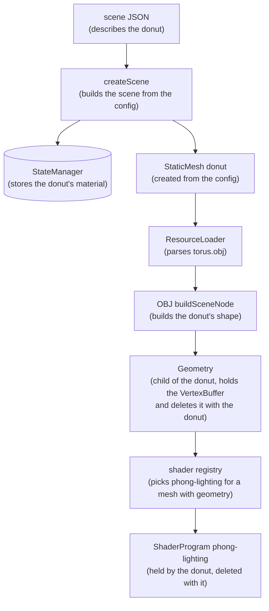
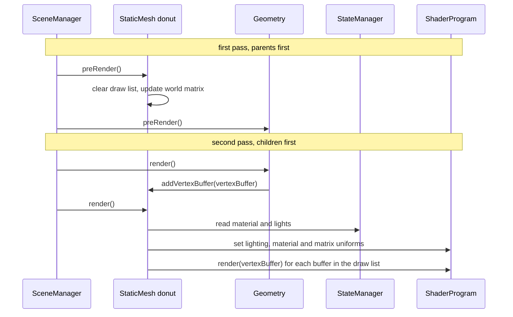

# scenic

Scene graph renderer. Early work in progress.

Scenic uses a configuration first approach to define a scene: a scene is a JSON
file describing a tree of nodes and their state, and Scenic builds and renders
that tree with WebGL.

The editor app renders a scene that you pick from a list. Here it is rendering
skinned animation:


Quick intro:

1. Click on the rendering canvas to take control of the camera
2. Move the mouse to look around
3. W and S fly forward and back, A and D fly left and right, E and Q fly up
   and down
4. Scroll (or two fingers on a trackpad) to fly forward, back, left and right
5. Press V to switch camera mode, in scenes with a character (the dancing
   character): first V looks out through the character's eyes, the next
   follows it from behind, and the next flies freely again. Looking through the
   eyes, the mouse looks around. Orbiting, the mouse orbits and scrolling zooms
6. Press ESC to let go of the camera
7. Use "Change scene" in the scene graph panel to switch to another scene

## Architecture

### Scene config and state

A scene file like
[`apps/editor/scenes/bump-lighting-sphere.json`](apps/editor/scenes/bump-lighting-sphere.json)
describes a tree of nodes. Each node has a `type`, a `name`, optional state
such as `transform` and `material`, and optionally a `resource` file to load
its shape from. The rest of this section uses a made-up `donut` node as its
example: a static mesh whose shape is loaded from an OBJ file of a torus.

```json
{
  "name": "donut",
  "type": "static-mesh",
  "resource": "/resources/obj/torus.obj",
  "material": {"color": [0.8, 0.5, 0.2, 1]}
}
```

Building a scene splits that config in two:

- The **`SceneManager`** holds the tree of nodes: what exists and how it is
  nested.
- The **`StateManager`** holds the state of every node, keyed by node ID:
  transforms, materials, lights, animation settings. Nodes read their state
  from it every frame, and the editor's panels write to it.

### Viewports and cameras

A **`Viewport`** is a part of the scene seen through a camera. Its items are
what it draws, and its cameras are the angles it can draw them from. The
editor's scenes have two viewports: `world`, with the lights and models, and
`axis`, with the axis gizmo in the corner.

A **`Camera`** is a lens plus a placement:

- Its `projection` block is the lens. Its `type` is one of:
  - `perspective`, which makes things further away look smaller. It takes
    `fov` (the vertical field of view in degrees), `near` and `far`.
  - `orthographic`, which keeps things the same size however far away they
    are. It takes `far`, and is measured in pixels from the bottom left of the
    canvas, which is what the axis gizmo needs.
- Its `transform` places it in the world like any other node. It looks down
  its own -Z axis.

A viewport can have several cameras, and draws through one of them at a time:
the camera named by `activeCamera` in the viewport's state, or its first camera
when that is not set. Switching cameras is a state change:

```js
sceneManager.updateNodeStateByID("world", {activeCamera: "side camera"});
```

Each camera keeps its own state, so switching back returns to where that camera
was left. A name that matches no camera falls back to the first camera, with a
warning in the console.

A viewport must always have a camera. Loading a scene with a viewport that has
no camera fails with an error that names the viewport, and removing a
viewport's last camera throws.

```json
{
  "name": "world",
  "type": "viewport",
  "items": [
    {
      "name": "camera",
      "type": "camera",
      "projection": {"type": "perspective", "fov": 30, "near": 1, "far": 10000},
      "transform": {"position": [0, 0, 300]},
      "camera": {"freeFly": {"speed": 200, "maxPitch": 89}}
    }
  ]
}
```

#### Camera modes

The editor controls the world viewport's active camera in one of a few modes,
and V switches between them. Each mode is a camera behavior in the
`@scenic/camera` package (`packages/camera/`), and the one in use is
`cameraMode` in the world viewport's state. A camera can only use the modes its
`camera` block has settings for; free-fly is used otherwise.

- **Free-fly** (`freeFly`) flies the camera around the scene. Its rotation is
  `[pitch, yaw, 0]` in degrees, and lights and models stay where they are in
  the world while it moves around them.
  - `speed`: how fast it flies, in scene units per second.
  - `maxPitch`: how far up or down it can look, in degrees. Looking straight up
    or down would flip the camera over, so keep this under 90.
- **First-person** (`firstPerson`) looks out from a node, such as a
  character's head bone, and moves with it, animation included. The mouse looks
  around from there, and the camera cannot move on its own.
  - `target`: the node to look out from (see targets below).
  - `offset`: where the camera sits relative to the target, in the target's
    own coordinates, as `{"position": [x, y, z], "rotation": [x, y, z]}`.
  - `maxPitch`: how far up or down it can look from where the target faces, in
    degrees.
- **Third-person** (`thirdPerson`) stays behind a node, such as a character,
  and follows it as it moves and turns. When the node turns, the camera swings
  around with it, staying level: only the node's heading counts, not its
  leaning or tilting. The node's front is its local +Z axis. The mouse orbits
  around it from there, and scrolling zooms in and out.
  - `target`: the node to orbit and follow (see targets below).
  - `offset`: where the orbit's pivot is relative to the target's position, in
    world coordinates, as `[x, y, z]`.
  - `distance`, `minDistance`, `maxDistance`: how far from the pivot the camera
    starts, and how close and far zooming can go, in scene units.
  - `rotation`: the orbit it starts with, as `[pitch, yaw]` in degrees,
    relative to behind the target. A yaw of 0 is directly behind it, and a
    negative pitch looks down at it.
  - `maxPitch`: how far above or below the target it can orbit, in degrees.
  - `followTime`: how quickly the camera catches up when the target turns, in
    seconds. After `followTime` it has closed about two thirds of the gap, so a
    quick turn swings the view around smoothly instead of snapping. 0 keeps it
    exactly behind.

A **target** names a node in two parts, `{"nodeID": ..., "boneName": ...}`,
so that it picks out one character even when several share the same model:

- `nodeID`: the ID of a node from the scene config, such as a character. Node
  IDs are unique.
- `boneName`: the name of a node inside the `nodeID` node, such as a bone of a
  character's skeleton. It is only looked up there, where a skeleton's bone
  names are unique. Without it, the target is the `nodeID` node itself, which
  is how a model without a skeleton is targeted: the Jedi star fighter's
  third-person camera uses `{"nodeID": "jedi star fight"}`.

The camera waits until the target exists, since a model's bones only exist
once it has loaded, and finds it again if the model is rebuilt. An FBX model's
node names are the same every time it loads; a name that repeats within one
file gets `_n1`, `_n2` and so on.

V cycles through the modes in that order, skipping the ones the active camera
has no settings for. The dancing character's camera has all three:

```json
"camera": {
  "freeFly": {"speed": 200, "maxPitch": 89},
  "firstPerson": {
    "target": {
      "nodeID": "skinning mesh animation",
      "boneName": "mixamorig:Head - Model_LimbNode"
    },
    "offset": {"position": [0, 6.4, 9.3], "rotation": [0, 180, 0]},
    "maxPitch": 80
  },
  "thirdPerson": {
    "target": {
      "nodeID": "skinning mesh animation",
      "boneName": "mixamorig:Hips - Model_LimbNode"
    },
    "offset": [0, 40, 0],
    "distance": 400,
    "minDistance": 100,
    "maxDistance": 1500,
    "rotation": [-15, 0],
    "maxPitch": 80,
    "followTime": 0.4
  }
}
```

The first-person offset puts the camera between the eyes, and turns it around
to face the same way as the head: the camera looks down its own -Z axis, and
the head's front is its +Z. The third-person offset moves the orbit's pivot up
from the hips to the chest.

### Scripts

A script lets code decide what a node does each frame, such as moving it,
without writing a new node type. A node's config attaches one with `script`,
and the script's `settings` are part of the node's state:

```json
{
  "name": "light-cyan",
  "type": "light",
  "script": {
    "src": "scripts/orbit.js",
    "settings": {"center": [0, 150, 0], "radius": 300, "speed": 60, "phase": 120}
  }
}
```

A script exports a factory that takes the node and returns the script's hooks,
so every node using it gets its own instance:

```js
const {angles} = require("@scenic/math");

module.exports = function createScript(node) {
  return {
    preRender(context) {}, // just before the node's own preRender
    render(context) {}, // just after the node's own render
    dispose() {}, // when the scene is disposed
  };
};
```

Every hook is optional. `SceneManager` calls `preRender` before the node's own,
so changes the script makes to the node's state show up in the same frame.
`context` has the frame's time in `ms` and the `sceneManager`. Scripts are
loaded with the scene, and `src` is relative to the editor page.

Scripts run like CommonJS modules: the editor fetches the script and runs it
inside a function given `require`, `module` and `exports`
(`apps/editor/script-loader.js`). `require` returns the app's own copies of
`@scenic/math`, `@scenic/scene`, `@scenic/animation` and `@scenic/renderer`, so
scripts share the app's classes, and requiring anything else is an error.
Scripts that need other libraries can bundle them with their own build: write
ES modules, mark the `@scenic` packages as external, and output CommonJS. A
bundled `export default` works too. Errors in a script show the script's name,
because the editor names its code with `//# sourceURL`.

The dancing character's three lights each run `apps/editor/scripts/orbit.js`,
with phases of 0, 120 and 240 degrees, so they circle the dancer evenly spaced.

The Jedi star fighter runs `apps/editor/scripts/hover.js`, which makes it bob,
bank and tip its nose as if it were holding position in the air:

```json
"script": {
  "src": "scripts/hover.js",
  "settings": {"bob": 5, "roll": 6, "pitch": 2, "period": 6}
}
```

### Reference floor

A `grid` node draws a flat grid of lines on the ground, to make it easier to
see things move through space, especially from a third-person camera. It lies
across its own X/Z plane, centered on its origin, and its transform places it.
The dancing character's scene has one at the character's feet:

```json
{
  "name": "floor",
  "type": "grid",
  "grid": {"size": 3000, "spacing": 50},
  "material": {"color": [0.35, 0.35, 0.35, 1]}
}
```

- `grid.size`: how far the grid reaches from one edge to the other, in scene
  units.
- `grid.spacing`: the distance between lines, in scene units.
- `material.color`: the color of the lines.

The grid is part of the editor (`apps/editor/grid.js`) rather than the engine
packages, like the axis gizmo.

### Specular highlights and fog

Lit meshes get Blinn-Phong specular highlights from every light, on top of
diffuse lighting. A mesh's material can tune them:

```json
"material": {"color": [1, 1, 1, 1], "reflectiveness": 1, "specular": 0.5, "shininess": 32}
```

- `material.specular`: how bright highlights are, 0.5 by default. 0 turns
  them off.
- `material.shininess`: how tight highlights are, 32 by default. Higher is a
  smaller, sharper highlight.

Highlights are scaled by `reflectiveness` like diffuse light, so a material
that does not reflect light, like the axis gizmo's, has none.

A viewport's `fog` fades what it draws toward a color the farther it is from
the active camera, starting at `near` and fully fogged at `far`. Every scene's
`world` viewport has black fog, which matches the background:

```json
{
  "name": "world",
  "type": "viewport",
  "fog": {"color": [0, 0, 0], "near": 1000, "far": 3000},
  "items": []
}
```

Without `fog`, or with `"enabled": false`, a viewport has none.

Both can be adjusted live in the editor: specular and shininess on a lit
material's Material tab, and fog on a viewport's Fog tab. The viewport gives renderables the camera
position and fog settings as view uniforms (`getViewUniforms`), next to their
view-projection matrix.

### Renderable, Mesh and Geometry

Drawing is split across three kinds of nodes:

- A **`Renderable`** is a node that can draw. It owns a shader program and has
  a per-frame _draw list_ (`vertexBuffers`) of buffers to draw.
- A **`Mesh`** is a `Renderable` that draws lit, shaded surfaces. It reads its
  material and the scene's lights from the state manager and sets them as
  shader uniforms. `StaticMesh` and `SkinnedMesh` are the two kinds of mesh.
- A **`Geometry`** is the shape: it owns a `VertexBuffer` (positions, normals,
  UVs, indexes, ...). It is _not_ a renderable. Every frame it adds its buffer
  to the draw list of its closest parent `Renderable`.

`Light` is also a `Renderable`. It draws its marker shape unlit, from the same
kind of `Geometry`-filled draw list.

#### What extends what

```text
Node                    every node in the scene graph
├── Renderable          has a shader program and a per-frame draw list
│   ├── Mesh            draws lit, shaded surfaces
│   │   ├── StaticMesh
│   │   └── SkinnedMesh
│   └── Light           draws its marker shape unlit
└── Geometry            owns a VertexBuffer; not a Renderable
```

### From config to a static mesh

Using the `donut` as the example:



1. `createScene` turns the config into a `StaticMesh` node and puts its
   `material` into the state manager.
2. The resource loader parses `torus.obj` in a web worker.
3. The OBJ loader's `buildSceneNode` creates a `VertexBuffer` from the parsed
   vertices and wraps it in a `Geometry` child of the mesh.
4. The shader registry gives the mesh a `phong-lighting` shader program, now
   that it has geometry to draw (see [Shaders](#shaders)).

The resulting scene graph:

```text
Viewport "world"
└── StaticMesh "donut"       ← Renderable: shader program + draw list
    └── Geometry "geometry"  ← owns the VertexBuffer
```

FBX models follow the same pattern with more node types: an FBX `Mesh` has
`Geometry`, `Material` and `Texture` children, and the FBX `Geometry` adds
skinning on top of the scene `Geometry`.

### Shaders

Which shader a renderable draws with is decided by a `ShaderRegistry` from
`@scenic/renderer`, and it is the only place shader programs are created. The
editor creates one (`apps/editor/shader-registry.js`), and code that defines a
renderable registers its shader on it next to the renderable, as a name or as
a function that picks one for a particular node:

```js
shaderRegistry.register(Grid, "shaders/flat-material");
shaderRegistry.register(Mesh, (mesh) => (hasGeometry(mesh) ? "shaders/phong-lighting" : null));
```

A node uses the registration of its most specific class, so the FBX `Mesh`
registers its own choice over the scene `Mesh`'s: the textured shader when it
has textures. A function returns null for a node that draws nothing, such as
the config node an FBX model is loaded into, so it gets no program.

The editor's `applyShaders` gives every renderable in a subtree that has no
program the one the registry picks, loading each shader file the first time it
is needed. It runs when a scene starts, for renderables like grids, and after
the resource loader builds a model. It stays in the editor, along with loading
the shader files, because it finds renderables with `@scenic/scene`'s classes,
and a copy of those bundled into `@scenic/renderer` would not match the
editor's nodes.

### Rendering a frame

`SceneManager.render` walks the tree twice. The first pass calls `preRender` on
every node, parents before children, so that every world matrix is up to date,
including the camera's. The second pass calls `render` on every node, children
before parents, so by the time a mesh renders its children have already filled
its draw list:



Other children configure their parent the same way. A `Texture` adds its
texture uniforms to the parent's shader program when it renders.

### Disposing a scene

`renderScene` returns a `dispose` function, and the editor calls it before
rendering another scene. It stops the render loop, stops loading resources,
and calls `SceneManager.dispose(gl)`, which walks the tree so that every node
deletes the GPU resources it owns.

## File formats

It has support for loading FBX files with most features. But there are a few
that are not supported like pre rotation and post rotation matrices. Usually
if a model cannot be loaded is because of that. Just import it and re-export
it in Blender for now.

It also has support for OBJ files (without mtl). Usually a quick way to feed
some geometry for rendering.

## Dev

On a fresh clone, please run `npm install` to get all your dependencies ready.

To start up the dev server you can `npm run start-dev`. That will startup
the build system, file watching, and your local dev server. To load up the
editor you can navigate to http://localhost:3000/apps/editor/index.html.
To stop the dev server you can use `npm run stop-dev`.
To see the build processes you can use `npm run monit`. Or if you want an aggregated logs for the build and dev server you can use `npm run logs`.

The dev watchers only rebuild the editor bundles. If you change anything under
`packages/`, run `npm run build` to rebuild the packages too.

The usual `npm run test` will run all the tests.

`npm run build` builds every package and the editor without minification,
which keeps things faster and easier to debug in the browser. Use
`npm run build:prod` for minified bundles.

The editor generates three bundles:

1. The editor app (`dist/editor.js`). This is the UI: the scene selector,
   the scene graph panel, and the canvas and input handling. Eventually this
   will get renamed to playground.
2. The scene bundle (`dist/scene.js`), exported as `window.scene`. This is
   where scenes are built and rendered with `renderScene`, and where most of
   the logic for FBX animation lives while support for it is implemented.
3. File formats (`dist/file-formats.js`). This is meant to be loaded in a web
   worker for parsing OBJ files. This can be easily extended to support
   parsing other file formats if needed.

The engine itself lives in the `@scenic/*` packages under `packages/`. See
[`packages/README.md`](packages/README.md).

## Prod

TBD
