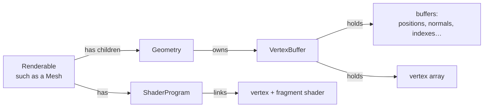
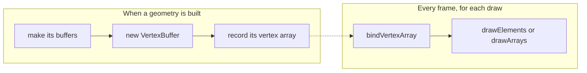

# Drawing: shader programs and vertex buffers

Everything the engine draws is a **renderable**, such as a mesh, the
terrain, the sky or a light, drawn with WebGL2. Two things do the drawing:

- A **shader program** (`ShaderProgram`, in
  [`program.js`](packages/renderer/src/program.js)): a linked pair of
  shaders, a vertex shader and a fragment shader, and the uniforms the
  renderable sends them, such as its lights, material and world matrix.
- A **vertex buffer** (`VertexBuffer`, in
  [`vertexbuffer.js`](packages/renderer/src/vertexbuffer.js)): a geometry's
  buffers, such as its positions, normals and indexes, and a vertex array
  that records which buffer each of the shader's inputs reads.

A renderable has one shader program, and one vertex buffer for each of its
geometries. Drawing it is: make its program the one in use, send its
uniforms, then, for each of its vertex buffers, bind its vertex array and
make the draw call.



Everything that stays the same from frame to frame, such as compiling and
linking shaders, uploading vertex data and recording vertex arrays, happens
when a shader, a geometry or a texture is loaded or changes. Every frame,
drawing only uses what was set up (see "Best practices for the hot path" in
the [README](README.md)).

## The WebGL context

Apps make their context with `webgl.createContext(canvas)`, from
`@scenic/renderer`, which asks the canvas for WebGL2 and fails if it can't
have it. The engine uses WebGL2's vertex arrays, `#version 300 es` shaders,
32 bit indexes and float textures.

## Shaders

### Shader files

Shaders are files in [`packages/runtime/shaders`](packages/runtime/shaders),
in pairs, a `.vert` and a `.frag` with the same name, in GLSL ES 3.00. A
shader's name is its path in the runtime package without the extension,
such as `"shaders/phong-lighting"`.

| Shader           | Draws                                                               |
| ---------------- | ------------------------------------------------------------------- |
| `phong-lighting` | lit meshes, with materials, lights and fog, and skinned fbx models  |
| `phong-texture`  | lit meshes with textures: fbx models' and static meshes'            |
| `flat-material`  | unlit shapes in one color, such as a light's marker and fbx bones   |
| `terrain`        | the terrain's tiles, blending grass, dirt tracks and their textures |
| `sky`            | the sky: one triangle covering the screen, with its clouds and sun  |
| `grid`           | a grid of lines on the ground, filled or see-through                |

### Loading and compiling

The runtime's shader factory ([`shader-factory.js`](packages/runtime/src/shader-factory.js))
loads a shader's two files the first time something needs it, and keeps
their source, by name. Files are asked for at the app's version, set with
`setShadersVersion`, so that browsers keep them until the app changes.
Asking for a shader again while it loads waits for the same load.

Each shader is compiled once, the first time a program is made from it, and
the compiled shaders are kept with its source. A shader that fails to
compile logs each error with the lines of source it points at (see
`parseShaderCompilationErrors` in `program.js`).

### Choosing a shader: `ShaderRegistry`

What kind of thing a renderable is decides which shader it draws with. Code
that defines a kind of renderable registers its shader next to it, on the
runtime's `shaderRegistry`
([`shader-registry.js`](packages/runtime/src/shader-registry.js)):

```js
shaderRegistry.register(Sky, "shaders/sky");
shaderRegistry.register(Mesh, (mesh) => (hasGeometry(mesh) ? "shaders/phong-lighting" : null));
```

A registration is a shader's name, or a function that picks one for a
renderable, or returns `null` when the renderable draws nothing. A
renderable uses the registration of its most specific class, so a subclass
can register its own shader over its parent's.

`applyShaders` gives every renderable under a node that has no shader
program the one its registration picks. It runs once nodes are built, such
as when a scene loads or a model finishes loading (see `load-scene.js` and
`resource-loader.js`), since what a node draws can decide its shader, such
as an fbx mesh or a static mesh with textures drawing with `phong-texture`
(see "Textures on a static mesh" in the README).

## Shader programs: `ShaderProgram`

### Linking

A program is made from a shader's two compiled shaders, by
`ShaderProgram.createWithCompiledShaders`, which links them
(`linkShaderProgram`):

1. It attaches the vertex and fragment shaders.
2. It binds every vertex attribute to its location in `vertexAttributes`,
   the same in every program (see [Vertex arrays](#vertex-arrays)).
3. It links and validates the program, and throws with WebGL's log when it
   doesn't link.

4. It makes the program's uniforms (see [Uniforms](#uniforms)).

Each call links a new WebGL program. `applyShaders` asks for one for each
renderable, so each renderable has a WebGL program of its own, given to it
with `withShaderProgram` (see
[`renderable.js`](packages/scene/src/renderable.js)). The renderable owns its
program, and deletes it when it is disposed. The compiled shaders are kept,
since other programs are made from them.

### Uniforms

A uniform is a value a shader reads that is the same for every vertex of a
draw, such as `projectionMatrix`, `worldMatrix` or `materialColor`. A
program keeps each uniform's value until it is sent another one.

When a program is made, it asks WebGL for every uniform its shaders have,
and makes a `ShaderUniform` for each (see
[`uniform.js`](packages/renderer/src/uniform.js)), with the uniform's name,
its location, and the values last sent to it. They are kept in the
program's `uniforms`, by name, as WebGL names them: `materialColor`, or, for
a field of an array of structs, `lights[0].position`.

`program.uniform(name)` is the uniform named `name`. A name the program's
shaders don't have gets a uniform whose setters do nothing, the way WebGL
does nothing with a uniform that has no location, so a renderable can set
every uniform it has a value for, such as fog, whichever shader it draws
with.

### Using a program, and setting uniforms

`use()` makes the program the one WebGL draws with, with WebGL's
`gl.useProgram`, unless it already is. Which program each context has in use is kept in
`programsInUse`.

Once its program is in use, a renderable sets its uniforms, with each
uniform's setter, one for each kind of value: `set1f` for a number, `set1i`
for an integer or a boolean, such as a texture unit, `set2fv`, `set3fv` and
`set4fv` for two, three or four numbers, such as a color, and
`setMatrix4fv(transpose, values)` for a matrix:

```js
program.use();
program.uniform("materialColor").set4fv(material.color);
program.uniform("projectionMatrix").setMatrix4fv(false, viewProjection.data);
```

A setter sends its value only when the program doesn't have it already:
each uniform keeps the values it last sent, and a setter given the same
values returns without calling WebGL. Lights, fog and materials, which are
the same frame after frame, are sent once, and after that only what
changes is.

Uniforms are set by whatever has their values, each with
`setUniforms(program, context)`, which writes its values into `program`, the
program being set up to draw, not into a program of its own. The viewport,
for one, has no program: as the terrain draws, the viewport's
`setUniforms` puts its view-projection, camera and fog into the terrain's
program.

`setUniforms` is part of `render`. It is only ever called as a renderable's
`render` starts, by `useProgram` (see
[Where `setUniforms` is called](#where-setuniforms-is-called)), and it is
split out of `render` only so that each owner sets its own values: a
renderable its own, and its viewport the view's. So it runs at
the same moment as the `render` that calls it, with the same `context`,
and it can do what `render` does: read state through
`context.sceneManager`, such as a mesh's material, and use the WebGL
context, `context.gl`, such as to bind a texture, the same way `render`
uses it for depth and blending.

Every `setUniforms` is called with both, so that they are all called the
same way, and one that doesn't need `context`, such as the viewport's,
leaves it out, the way a node's `prepareForView()` can.

A renderable's `render` starts with `useProgram(context)`, which activates
its program and returns it, ready to draw the renderable. Activating it
makes it the program in use, with `use()`, and gives it its uniforms: the
renderable's own `setUniforms`, then its viewport's (see
[`renderable.js`](packages/scene/src/renderable.js)). Then `render`
draws:

```js
render(context) {
  const program = this.useProgram(context);
  program.draw(this.vertexBuffer);
}
```

A renderable without values of its own, such as an fbx skeleton, keeps
Renderable's `setUniforms`, which sets nothing.

- **The viewport** sets how it is seen: its
  view-projection matrix, where its camera is, and its fog (see
  [`viewport.js`](packages/scene/src/viewport.js)).
- **A renderable** sets the values it has, such as a sky's colors or a
  grid's lines. A mesh's are its lights, by their index in the shader's
  lights, and its material (see [`mesh.js`](packages/scene/src/mesh.js)).
  The terrain, a mesh, adds its textures and their settings to a mesh's,
  and an fbx mesh adds those of the fbx nodes under it.
- **A `Material` node** holds a mesh's material: its color, its ambient
  color, how much light it reflects, and its specular highlights. The mesh
  reads it, under its own state's material and ambient, which win, and
  over `specularDefaults`, and sets each uniform once, from whichever
  layer has a value (see `setMaterialUniforms` in `mesh.js`).
- **An fbx model's nodes** that have uniforms of their own have
  `setUniforms(program, context)` too, which the fbx mesh's calls: each
  `Texture` under its `Material`, which binds itself to its unit and turns
  itself on, and its skinned `Geometry`, which uploads its bone matrices
  and turns skinning on (see `Mesh` in
  [`scene-node.js`](packages/runtime/src/loaders/fbx/scene-node.js)).

A mesh drawn at many places, such as a forest's trees, sets its uniforms
once, then each copy's world matrix before drawing the copy, in its
`render`, since it changes from copy to copy:

```js
const worldMatrix = program.uniform("worldMatrix");
for (const {worldMatrix: copyWorldMatrix} of copiesToRender) {
  worldMatrix.setMatrix4fv(true, copyWorldMatrix.data);
  program.draw(vertexBuffer);
}
```

### Where `setUniforms` is called

`setUniforms` is part of `render`, and is only called as `render` starts,
by `useProgram`, through the places below.

Called anywhere else, such as in `preRender` or `prepareForView`, a
`setUniforms` sets nothing, and its values can go missing for good: the
renderable draws with old ones, such as last frame's material color, and
the browser logs `INVALID_OPERATION` warnings. WebGL only sets a
program's uniform while that program is in use, and outside `render`,
another program, or none, is. The uniform still keeps the value as sent,
so its setter skips it from then on, while the program never had it.

So `setUniforms` is only ever called from these places, all of them as a
renderable's `render` starts, after its program's `use()`:

1. **Renderable's `useProgram`**, which every `render` starts with, calls
   the renderable's own `setUniforms(program, context)` and its viewport's,
   right after `use()`. No `render` calls a `setUniforms` itself.
2. **A renderable's `setUniforms`** calls the one it adds to, with
   `super.setUniforms(program, context)`: the terrain's and the fbx mesh's
   call Mesh's.
3. **The fbx mesh's `setUniforms`** calls those of the fbx nodes under it:
   its skinned `Geometry`'s, and each `Texture`'s under its `Material`.

A new kind of value goes in the `setUniforms` of whatever has it, which
`useProgram` reaches through one of these. A node under a renderable that has
uniforms of its own gets a `setUniforms`, called from its renderable's
`setUniforms`, the way the fbx mesh calls its textures'. Nothing walks the
scene looking for nodes with a `setUniforms`.

### Drawing

`draw(vertexBuffer, primitiveType)` draws a vertex buffer with a program in
use: it binds the buffer's vertex array, then calls `drawElements` with its
indexes, or, without indexes, `drawArrays` with its positions. It draws
triangles unless told otherwise, such as `gl.LINES` for an fbx model's
bones.

Every draw is counted in `renderStats`, with the triangles it drew, for
apps to show what a frame costs. The render loop starts a new count each
frame (see `render-loop.js`).

### Rules for shader programs

- **Use the program, then set its uniforms, then draw,** all in `render`,
  which `useProgram` does the first two of. WebGL only sets a uniform of
  the program in use, so a uniform set before `use()`, or outside
  `render`, is never set (see
  [Where `setUniforms` is called](#where-setuniforms-is-called)).
- **Set uniforms only with their setters.** The values each uniform keeps
  are only right if every value its program gets goes through them. A
  value sent with the WebGL context itself would leave them stale, and a
  later value the program needs could be skipped.
- **Set a value once a frame.** A uniform set to two different values in
  one frame, such as a default and then a material's, sends both, every
  frame. Work the value out first, then set it, the way
  `setMaterialUniforms` does.

## Vertex buffers

### Buffers

Each buffer holds one kind of data for every vertex of a geometry, uploaded
to the GPU once, when it is made, with `STATIC_DRAW`:

| Class                     | Holds                                                                                      | Data           |
| ------------------------- | ------------------------------------------------------------------------------------------ | -------------- |
| `VertexBufferData`        | per vertex numbers: positions, normals, colors, tangents, bitangents, bone weights and ids | `Float32Array` |
| `TextureVertexBufferData` | texture coordinates, two per vertex                                                        | `Float32Array` |
| `VertexBufferIndexes`     | which vertices make each triangle                                                          | `Uint32Array`  |

A `VertexBufferData` knows how many numbers each vertex has,
`componentsPerVertex`, 3 unless given another, which `drawArrays` uses to
count vertices. Its `update(data)` uploads new data to the same buffer,
for data that changes, such as an fbx bone's line, which moves every frame.

Each buffer has `bind()` and `dispose()`, which deletes it from the GPU.

### `VertexBuffer`

A `VertexBuffer` holds a geometry's buffers, one for each vertex attribute
it has, by the attribute's `VertexBuffer` field (see
[`vertexAttributes`](#attribute-locations-vertexattributes)), and its
`indexes`:

```js
const vertexBuffer = new VertexBuffer({
  positions: new VertexBufferData(gl, positions),
  normals: new VertexBufferData(gl, normals),
  indexes: new VertexBufferIndexes(gl, indexes),
});
```

Its constructor takes every buffer, makes its vertex array, and records it
(see [Vertex arrays](#vertex-arrays)). Buffers that can only be made once a
geometry is built and in use are added with `addBuffers`, which records the
vertex array again, once:

```js
geometry.vertexBuffer.addBuffers({weights, boneids});
```

The fbx loader does this for a model's bone weights and ids, which come
from its skin, found only once the whole model is built. Everything else is
passed to the constructor.

A vertex buffer that is one of a mesh's levels of detail has a
`lodDistance`, the distance from the camera it is drawn from, set by the obj
loader (see `levelOfDetail` in [`mesh.js`](packages/scene/src/mesh.js)).

A `Geometry` node owns its vertex buffer, and disposes it with itself. Its
renderable keeps its geometries' vertex buffers, in `vertexBuffers`, as
geometries are added and removed, and the bounding volume around all of
them, so drawing never looks for them among its children.

## Vertex arrays

### What a vertex array holds

A vertex shader reads each vertex's data from its attributes, such as
`in vec3 position;` and `in vec3 normal;`. For a draw, WebGL needs to know,
for each attribute location:

- whether the attribute is enabled,
- which buffer it reads, and
- how to read it: how many numbers each vertex has, of what type, and where
  they start.

For `drawElements`, it also needs the index buffer.

A vertex array, a WebGL2 vertex array object (VAO), holds all of that.
While a vertex array is bound, every `enableVertexAttribArray`, every
`vertexAttribPointer` and the index buffer binding are stored in it, and
binding it again later brings all of it back, in one call.

A vertex array answers one question: where each vertex input comes from.
Everything else belongs to the program, to the context, or to the draw call.

**In the vertex array**, recorded while it is bound:

| State                                                                         | Set by                                                                                    | What it means for the engine                                                                                                                                        |
| ----------------------------------------------------------------------------- | ----------------------------------------------------------------------------------------- | ------------------------------------------------------------------------------------------------------------------------------------------------------------------- |
| Whether each attribute location is enabled                                    | `enableVertexAttribArray`, `disableVertexAttribArray`                                     | A geometry enables only the attributes it has buffers for.                                                                                                          |
| How each location reads its data: numbers per vertex, type, stride and offset | `vertexAttribPointer`                                                                     | Set from `vertexAttributes`, once, when the geometry is built.                                                                                                      |
| The buffer each location reads                                                | `vertexAttribPointer`, which records the buffer bound to `ARRAY_BUFFER` when it is called | Each buffer is bound just before its pointer is set.                                                                                                                |
| The index buffer                                                              | binding a buffer to `ELEMENT_ARRAY_BUFFER`                                                | Binding an index buffer while a vertex array is bound changes that vertex array, so index buffers are made with none bound (see [Rules](#rules-for-vertex-arrays)). |

**Not in the vertex array**:

| State                                                                                       | Where it lives                                                                 | What it means for the engine                                                                                                                                                                                                                                                                                                                                               |
| ------------------------------------------------------------------------------------------- | ------------------------------------------------------------------------------ | -------------------------------------------------------------------------------------------------------------------------------------------------------------------------------------------------------------------------------------------------------------------------------------------------------------------------------------------------------------------------- |
| The `ARRAY_BUFFER` binding                                                                  | the context                                                                    | Only a place for `vertexAttribPointer` to read a buffer from. Binding a buffer to `ARRAY_BUFFER`, to make or update vertex data, changes no vertex array, so it is safe at any time.                                                                                                                                                                                       |
| What is in each buffer                                                                      | the buffer                                                                     | A vertex array points at buffers, not their data, so data uploaded again with `update`, such as an fbx bone's line every frame, draws without recording anything again, and vertex arrays can share a buffer, such as the terrain's tiles' index buffers. A deleted buffer leaves the vertex arrays pointing at it unable to draw (see [Rules](#rules-for-vertex-arrays)). |
| Which shader input is at each location                                                      | the program                                                                    | Set when the program is linked, which is why every program binds the same locations (see [Attribute locations](#attribute-locations-vertexattributes)).                                                                                                                                                                                                                    |
| The value of an attribute a vertex array doesn't enable                                     | the context, set with `vertexAttrib4f` and the like, `(0, 0, 0, 1)` unless set | A shader reading an attribute the geometry has no buffer for, such as `color`, gets that value. The engine never sets it.                                                                                                                                                                                                                                                  |
| Uniform values                                                                              | the program                                                                    | Each program keeps the values it was sent until it is sent others, whichever vertex array is bound, which is what lets its uniforms skip values it has.                                                                                                                                                                                                                    |
| Which texture each texture unit has                                                         | the context, set with `activeTexture` and `bindTexture`                        | A renderable that draws with a texture binds it to its unit before drawing; a sampler uniform only says which unit to read.                                                                                                                                                                                                                                                |
| Blending, the depth test and depth writes, face culling, the viewport size, the framebuffer | the context                                                                    | Set around draws: the viewport turns on blending and turns off depth writes for translucent meshes, the grid turns off culling, and an fbx armature turns off the depth test.                                                                                                                                                                                              |
| How many vertices to draw, the index type, the primitive                                    | the draw call                                                                  | Arguments to `drawElements` or `drawArrays`, given with each draw (see [Drawing](#drawing)).                                                                                                                                                                                                                                                                               |

### Why the engine uses them

- **Drawing does only what drawing needs.** Which buffer each attribute
  reads stays the same for as long as a geometry exists, so it is set up
  once, when the geometry is built, and a draw is one bind and the draw
  call. The render loop runs for every geometry, every frame, and each
  WebGL call costs about as much as a draw.
- **One geometry works with any shader.** A geometry is recorded once, and
  can be drawn by any shader program, since every program reads each
  attribute at the same location.
- **Nothing is left over between draws.** Enabled attributes belong to the
  vertex array that enabled them, so one geometry's setup never carries
  over into the next draw.

### Attribute locations: `vertexAttributes`

`vertexAttributes`, in `vertexbuffer.js`, lists every attribute a shader can
read, with the location it is at in every program, how many numbers it has
per vertex, and the `VertexBuffer` field that holds its data:

| Attribute (in shaders) | `VertexBuffer` field | Location | Numbers per vertex |
| ---------------------- | -------------------- | -------- | ------------------ |
| `position`             | `positions`          | 0        | 3                  |
| `normal`               | `normals`            | 1        | 3                  |
| `color`                | `colors`             | 2        | 3                  |
| `textureCoord`         | `textureCoords`      | 3        | 2                  |
| `tangent`              | `tangents`           | 4        | 3                  |
| `bitangent`            | `bitangents`         | 5        | 3                  |
| `weight`               | `weights`            | 6        | 4                  |
| `boneid`               | `boneids`            | 7        | 4                  |

Every program binds these locations before it is linked (see
[Linking](#linking)). Without that, each program picks its own locations,
and a vertex array recorded with `position` at 0 would read the wrong
buffer for a program that put it at 2. A shader that doesn't declare an
attribute never reads its location, and a geometry without an attribute's
buffer leaves it disabled, so a shader that reads it gets a constant
default value.

### Recording

Recording, by the `VertexBuffer` constructor and `addBuffers`, binds the
vertex array, then, for each attribute the geometry has, binds its buffer,
enables its location, and points the location at the buffer, then binds the
index buffer, and unbinds the vertex array. `vertexAttribPointer` takes
whichever buffer is bound when it is called, which is why each buffer is
bound just before its pointer is set.



### Rules for vertex arrays

- **Make an index buffer with no vertex array bound.** Without unbinding
  the vertex array first, a geometry drawn earlier would draw with the new
  indexes from then on: its triangles scrambled, or missing. WebGL keeps
  which index buffer is bound as part of the vertex array that is bound,
  and after a draw, the vertex array of the geometry drawn last is still
  bound. `VertexBufferIndexes` unbinds the vertex array before it binds
  itself, and recording a vertex array always ends by unbinding it. Vertex
  data buffers are safe to make or update at any time: the bound
  `ARRAY_BUFFER` isn't part of a vertex array.
- **Delete a vertex array with its buffers, or before them.** A vertex
  array reading a buffer that has been deleted makes every draw with it
  fail, with `INVALID_OPERATION`. `VertexBuffer.dispose` deletes the vertex
  array and its buffers. The terrain's tiles share index buffers, so a tile
  deletes its vertex array with `disposeVertexArray`, and its own buffers,
  and the terrain deletes the shared index buffers only after all its
  tiles.
- **Record when building, never when drawing.** A vertex array is recorded
  by the `VertexBuffer` constructor and by `addBuffers`, which run while
  geometry is built or loaded. Nothing in the render loop records one.

### Adding an attribute

To give shaders a new attribute, such as a second set of texture
coordinates:

1. Add it to `vertexAttributes`, at the next free location, with its
   `VertexBuffer` field and how many numbers it has per vertex.
2. Declare it in the shaders that read it, with the same name:
   `in vec2 textureCoord2;`.
3. Pass its buffer to the `VertexBuffer` constructor, under its field:
   `textureCoords2: new VertexBufferData(gl, data, 2)`.

Every program binds the new location when it is linked, and every geometry
with the buffer records it, so nothing else changes.

## A frame, end to end

For a mesh, such as a tree of a forest drawn at many places, by its
viewport (see "The draw list" in the [README](README.md)):

1. `prepareForView` chooses the copies of the mesh in view, and adds the
   mesh to its viewport's draw list.
2. The viewport calls the mesh's `render`, in the mesh's render order.
3. `render` calls `useProgram`, which activates the mesh's program: it
   makes it the program in use, with `use()`, if it isn't, then gives it
   its uniforms.
4. The mesh's `setUniforms` gives it the mesh's lights and its material,
   from its `Material` node and its state, and, for an fbx mesh, its
   textures and bones. Its viewport's `setUniforms` gives it the
   projection, camera and fog. Each is sent only if the program doesn't
   have it.
5. For each copy, it sets the copy's world matrix, then draws each of the
   mesh's vertex buffers for the copy's level of detail: `bindVertexArray`,
   then the draw call.
